<div align="center">

# ianvex tv launcher

**Android TV / Google TV launcher with Android 17-style quick settings.**

A fork of [0xRampey/material-tv-launcher](https://github.com/0xRampey/material-tv-launcher),
customized for the ianvex TV. No ads, no recommendations, with Material You dynamic color
and optional Gemini voice (bring your own OpenRouter API key).

**Language:** [Bahasa Indonesia](README.md) · [English](README.en.md)

[](https://www.facebook.com/ianvex.id)
[](https://github.com/ianvex-96)
[](https://github.com/ianvex-96/ianvex-tv-launcher/releases/latest/download/ianvex-tv-launcher.apk)

</div>

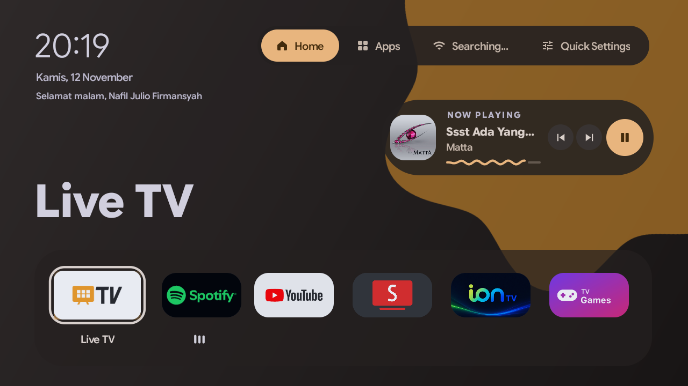

## Highlights

- **The ianvex tv launcher name** in the launcher, dialogs, and the About section.
- **Two languages**: Indonesian (default) and English, chosen in Launcher settings →
  Language. There is also a “Follow system” option.
- **Android 17-style quick settings**: a centered panel with rounded corners, a drag handle,
  a large clock + date, a 3×3 grid of large tiles (round icons, bold labels, live status),
  solid active tiles, brightness then volume sliders, and a Dock apps / Close footer.
- **Indonesian or English date & time**: `HH:mm` and dates such as “Kamis, 12 November”
  or “Thursday, 12 November”.
- **Greeting**: “Selamat pagi/siang/sore/malam, Name” or “Good morning/afternoon/evening/night, Name”,
  editable or switchable off.
- **Accent color**: 8 color choices + a “Follow app color” mode (dynamic color).
- **Screensaver**: three styles — Shapes + clock, Clock only, Dark — with a full-screen preview.
- **6-app dock**: search, reorder, one-click select, and save.
- **Tile menu (hold OK)**: pin/unpin the dock, app info, hide, uninstall.
- **Now Playing**: artwork, title, progress, play/pause, previous/next.
- **Extra tiles**: Wi-Fi, Bluetooth, Do not disturb, Mute, Screensaver, Screen off, Apps,
  Launcher, and TV settings.
- **Home button** still works through the built-in accessibility service.

## Screenshots

All screenshots come straight from an Android 14 TV (1280×720) running build 0.1.7 in Indonesian.
Click an image to open the full-size version. The English UI is available in the launcher
(Launcher settings → Language).

### Home, Apps, and quick settings

| Home | Apps |
|:---:|:---:|
| [](setup/screenshots/home.png) | [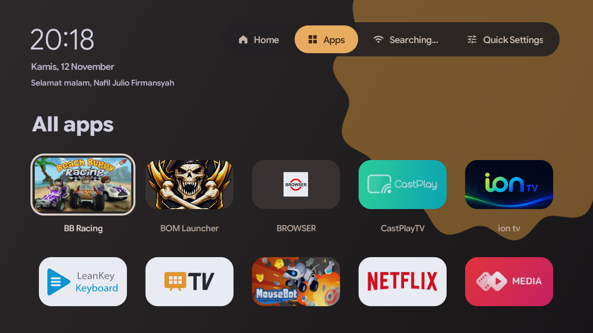](setup/screenshots/apps.png) |
| Indonesian greeting, Now Playing, and the 6-app dock | Grid of every installed app |

| Android 17-style quick settings |
|:---:|
| [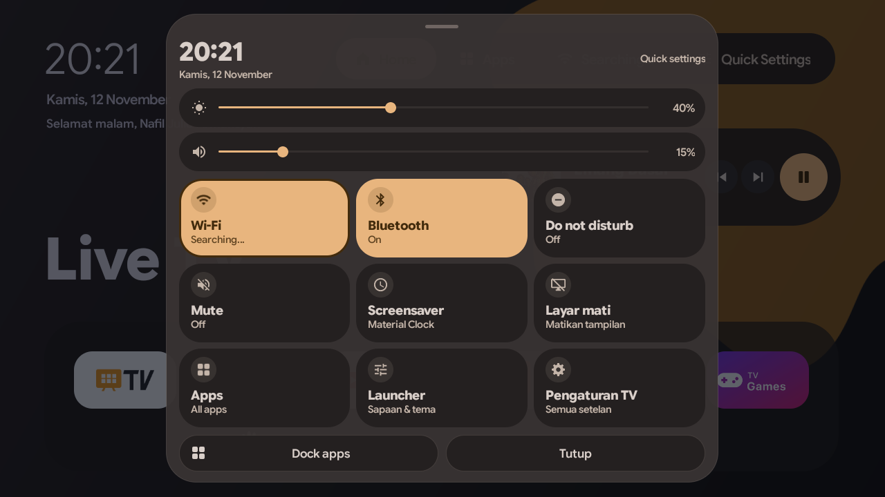](setup/screenshots/quick-settings.png) |
| Centered panel with clock, 9 tiles, brightness & volume sliders, and the Dock apps / Close footer |

### Launcher settings

| Launcher settings | Accent colors |
|:---:|:---:|
| [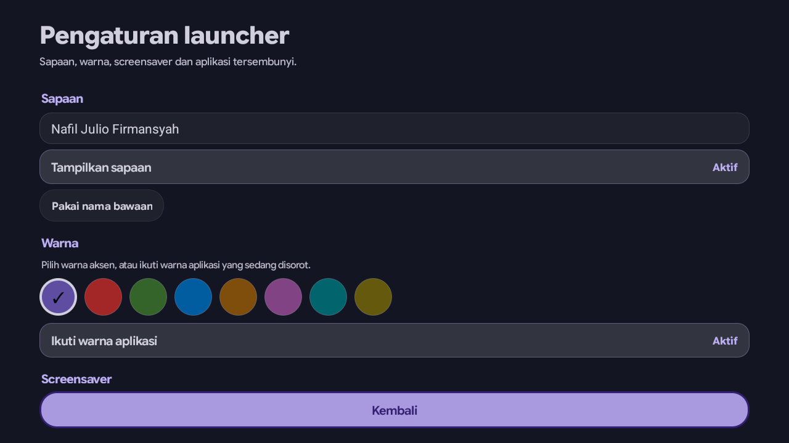](setup/screenshots/launcher-settings.png) | [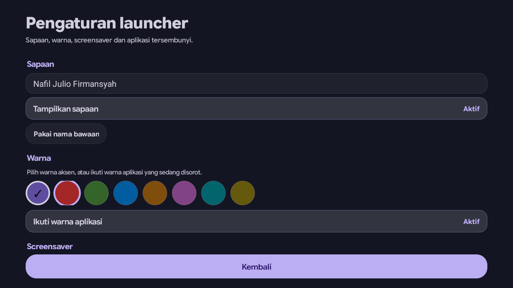](setup/screenshots/colors.png) |
| Greeting, name, language, and shortcuts to the other sections | 8 accent colors + Follow app color mode |

| Screensaver | Hidden apps & About |
|:---:|:---:|
| [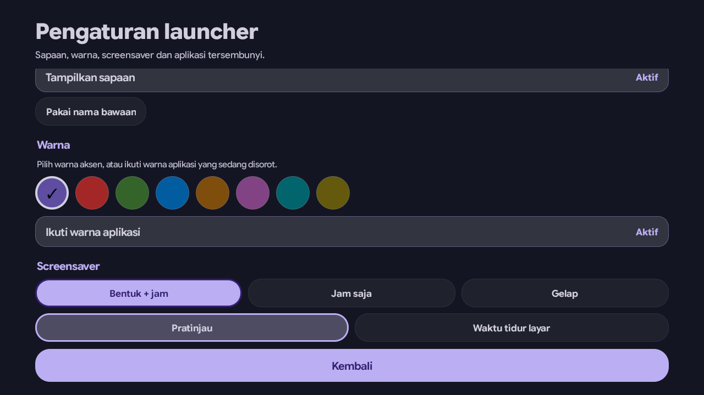](setup/screenshots/screensaver-settings.png) | [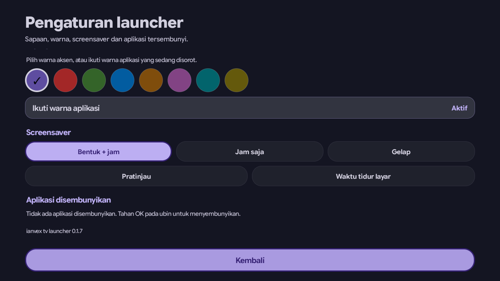](setup/screenshots/hidden-apps-about.png) |
| Three screensaver styles, Preview, and Screen timeout | Hidden app list and launcher version |

### The three screensaver styles

| Shapes + clock | Clock only | Dark |
|:---:|:---:|:---:|
| [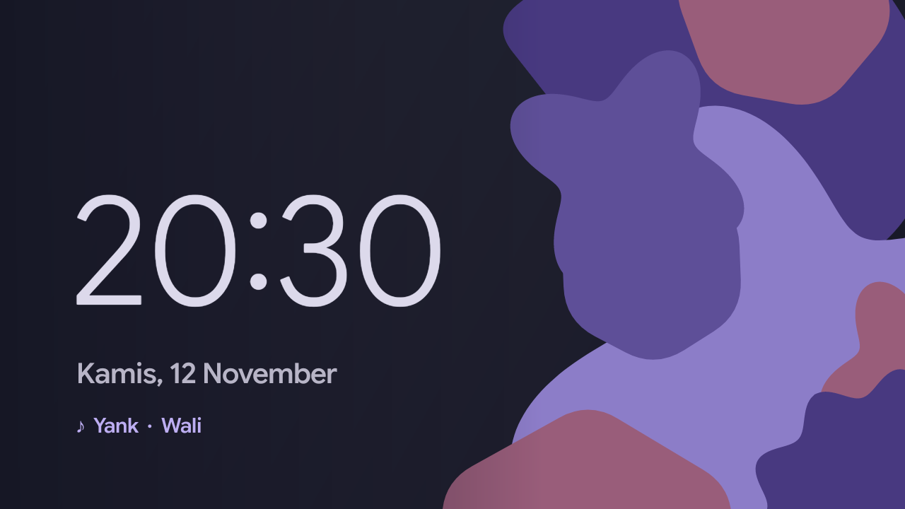](setup/screenshots/screensaver-shape-clock.png) | [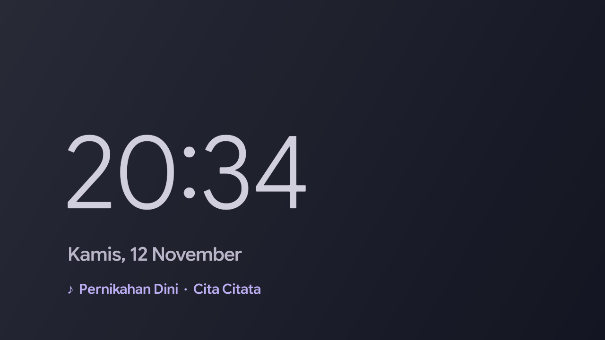](setup/screenshots/screensaver-clock.png) | [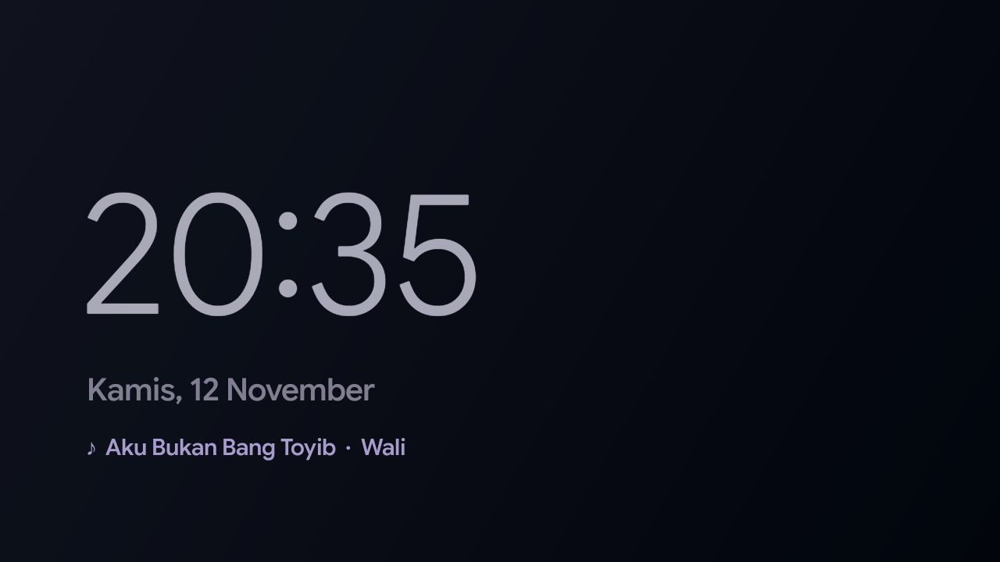](setup/screenshots/screensaver-dark.png) |
| Material You shape wallpaper + clock | Large clock over the wallpaper | Minimal dark background |

### Dock and tile menu

| Dock apps | Tile menu (hold OK) |
|:---:|:---:|
| [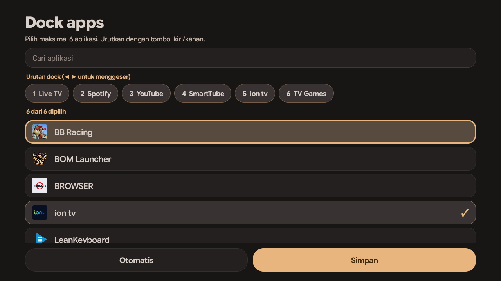](setup/screenshots/dock-apps.png) | [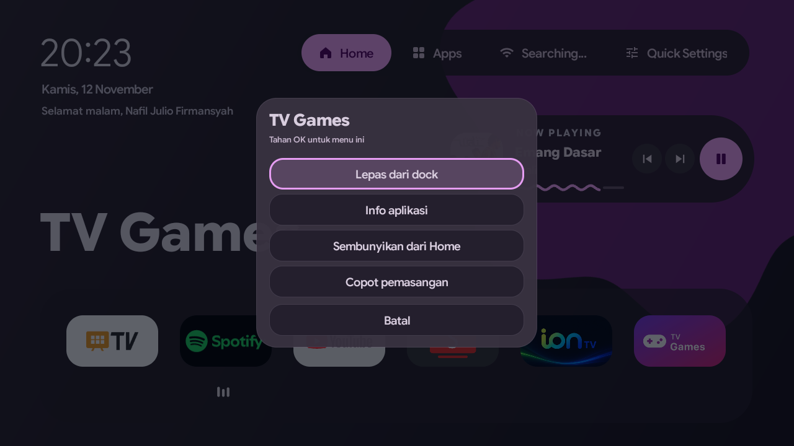](setup/screenshots/tile-menu.png) |
| Search, pick up to 6 apps, and reorder them | App info, hide from Home, uninstall |

## Quick start

Requirements: an Android TV / Google TV running **Android 12+** with USB debugging or network
debugging enabled, and a computer on the same network.

```sh
adb connect 192.168.7.102:5555
bash setup/install.sh 192.168.7.102
```

`install.sh` installs the APK, grants the permissions it needs, registers the accessibility
service for the Home button, then opens the launcher. To put the TV back the way it was:

```sh
bash setup/uninstall.sh 192.168.7.102
```

The ready-to-install APK is [`setup/ianvex-tv-launcher.apk`](setup/ianvex-tv-launcher.apk)
(build 231, versionName 0.1.8). Changes and permissions are detailed in
[`setup/CUSTOMIZATIONS.md`](setup/CUSTOMIZATIONS.md).

## Build it yourself

You need Android SDK platform 34, build-tools 34.0.0, and JDK 17+.

```sh
ANDROID_HOME=/path/to/android-sdk \
BUILD_TOOLS=34.0.0 \
VERSION_CODE=231 VERSION_NAME=0.1.8 \
bash build.sh
```

Output: `build/material-tv-launcher.apk`. The voice runtime (sherpa-onnx) is downloaded
automatically by `scripts/prepare-voice.py`; without it the build stops with a clear message.
This build only packages the **ARMv7** runtime, so the TV must support 32-bit ARM apps.

## Repo layout

```text
AndroidManifest.xml        app manifest (label: ianvex tv launcher)
build.sh                   Gradle-free build: aapt2 -> javac -> d8 -> zipalign -> apksigner
src/                       launcher Java sources
res/                       resources, icons, XML layouts
assets/                    fonts, voice detector, licenses
third_party/               material-color-utilities, sherpa-onnx
docs/                      upstream documentation and screenshots
scripts/                   build/voice utilities
tests/                     static checks and behavior tests
setup/                     ready-to-install APK, installer, patch, docs, screenshots
```

## Test status

Tested on an Android 14 TV (SDK 34), 1280×720, `armeabi-v7a` for build 0.1.7:

- Home, the Indonesian greeting, the dock, and Now Playing work.
- The new quick settings opens with all 9 tiles, sliders, and the footer visible.
- The Launcher settings page shows `ianvex tv launcher 0.1.7`.
- The Home button and screensaver still work.

Build **0.1.8** adds the Indonesian/English language choice. The build succeeded
(versionCode 231, versionName 0.1.8) and the APK is uploaded, but the on-TV test has not
run yet because the TV was unreachable from the build environment at release time.

## Social media

Follow launcher updates, new screenshots, and release notes on Facebook:

[](https://www.facebook.com/ianvex.id)

| Platform | Account |
|---|---|
| Facebook | [www.facebook.com/ianvex.id](https://www.facebook.com/ianvex.id) |
| GitHub | [github.com/ianvex-96](https://github.com/ianvex-96) |
| This repo | [ianvex-96/ianvex-tv-launcher](https://github.com/ianvex-96/ianvex-tv-launcher) |

If this launcher is useful, give the repo a ⭐ and share it with a friend.

## Credits & license

Original project: [0xRampey/material-tv-launcher](https://github.com/0xRampey/material-tv-launcher).
Code is licensed under **Apache 2.0**, see [`LICENSE`](LICENSE).

Bundled: [material-color-utilities](https://github.com/material-foundation/material-color-utilities)
(Apache 2.0), [Google Sans Flex](https://github.com/googlefonts/googlesans-flex) (SIL OFL 1.1),
sherpa-onnx (Apache 2.0), ONNX Runtime, and Silero VAD (MIT). “Google”, “Google Sans”, and
“Material Design” belong to Google; this project is not affiliated with Google.
