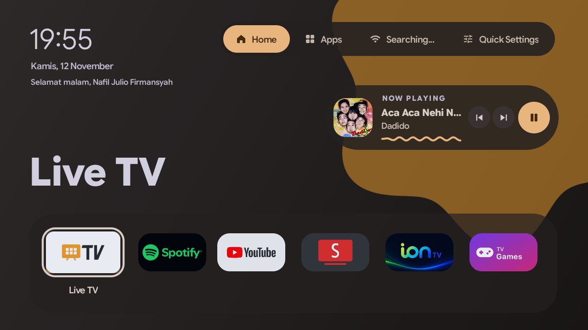

<div align="center">

# ianvex tv launcher

**Launcher Android TV / Google TV dengan quick settings gaya Android 17.**

Fork dari [0xRampey/material-tv-launcher](https://github.com/0xRampey/material-tv-launcher),
dikustomisasi untuk TV ianvex. Tanpa iklan, tanpa rekomendasi, dengan warna dinamis
Material You dan dukungan voice Gemini opsional (membawa API key OpenRouter sendiri).

</div>



## Fitur utama

- **Nama ianvex tv launcher** di launcher, dialog, dan halaman About.
- **Quick settings gaya Android 17**: panel di tengah dengan sudut membulat, drag handle,
  jam besar + tanggal Indonesia, grid 3×3 tile besar (ikon bulat, label tebal, status hidup),
  tile aktif berwarna solid, slider kecerahan lalu volume, serta footer Dock apps / Tutup.
- **Tanggal & jam Indonesia**: `HH:mm` dan tanggal seperti "Kamis, 12 November".
- **Sapaan**: "Selamat pagi/siang/sore/malam, Nama" yang bisa diubah atau dimatikan.
- **Warna aksen**: 8 pilihan warna + mode "Ikuti warna aplikasi" (dynamic color).
- **Screensaver**: tiga gaya — Bentuk + jam, Jam saja, Gelap — dengan pratinjau layar penuh.
- **Dock 6 aplikasi**: pencarian, ubah urutan, pilih sekali klik, dan simpan.
- **Menu tile (tahan OK)**: sematkan/lepas dock, info aplikasi, sembunyikan, copot pemasangan.
- **Now Playing**: art, judul, progress, play/pause, previous/next.
- **Tile tambahan**: Wi-Fi, Bluetooth, Do not disturb, Mute, Screensaver, Layar mati, Apps,
  Launcher, dan Pengaturan TV.
- **Home button** tetap bekerja lewat accessibility service bawaan.

## Mulai cepat

Syarat: TV Android TV / Google TV **Android 12+** dengan USB debugging atau network
debugging aktif, dan komputer yang terhubung ke jaringan yang sama.

```sh
adb connect 192.168.7.102:5555
bash setup/install.sh 192.168.7.102
```

`install.sh` memasang APK, memberi izin yang dibutuhkan, mendaftarkan accessibility service
untuk tombol Home, lalu membuka launcher. Untuk mengembalikan TV seperti semula:

```sh
bash setup/uninstall.sh 192.168.7.102
```

APK siap pasang ada di [`setup/material-tv-launcher-wifi.apk`](setup/material-tv-launcher-wifi.apk)
(build 230, versionName 0.1.7). Detail perubahan dan izin ada di
[`setup/CUSTOMIZATIONS.md`](setup/CUSTOMIZATIONS.md).

## Build sendiri

Butuh Android SDK platform 34, build-tools 34.0.0, dan JDK 17+.

```sh
ANDROID_HOME=/path/to/android-sdk \
BUILD_TOOLS=34.0.0 \
VERSION_CODE=230 VERSION_NAME=0.1.7 \
bash build.sh
```

Hasil build: `build/material-tv-launcher.apk`. Runtime voice (sherpa-onnx) diunduh otomatis
oleh `scripts/prepare-voice.py`; tanpa runtime tersebut build akan berhenti dengan pesan
yang jelas. Build ini hanya memaketkan runtime **ARMv7**, jadi TV harus mendukung aplikasi
32-bit ARM.

## Struktur repo

```text
AndroidManifest.xml        manifest aplikasi (label: ianvex tv launcher)
build.sh                   build tanpa Gradle: aapt2 -> javac -> d8 -> zipalign -> apksigner
src/                       source Java launcher
res/                       resource, ikon, layout XML
assets/                    font, voice detector, lisensi
third_party/               material-color-utilities, sherpa-onnx
docs/                      dokumentasi dan screenshot upstream
scripts/                   utilitas build/voice
tests/                     uji statis dan uji perilaku
setup/                     APK siap pasang, installer, patch, dokumentasi, screenshot
```

## Status uji

Diuji pada TV Android 14 (SDK 34), resolusi 1280×720, arsitektur `armeabi-v7a`:

- Home, sapaan Indonesia, dock, dan Now Playing berjalan.
- Quick settings baru terbuka dan seluruh 9 tile, slider, dan footer terlihat.
- Halaman Launcher settings menampilkan `ianvex tv launcher 0.1.7`.
- Home button dan screensaver tetap berfungsi.

## Kredit & lisensi

Proyek asli: [0xRampey/material-tv-launcher](https://github.com/0xRampey/material-tv-launcher).
Kode dilisensikan **Apache 2.0**, lihat [`LICENSE`](LICENSE).

Bundled: [material-color-utilities](https://github.com/material-foundation/material-color-utilities)
(Apache 2.0), [Google Sans Flex](https://github.com/googlefonts/googlesans-flex) (SIL OFL 1.1),
sherpa-onnx (Apache 2.0), ONNX Runtime, dan Silero VAD (MIT). "Google", "Google Sans", dan
"Material Design" milik Google; proyek ini tidak berafiliasi dengan Google.
